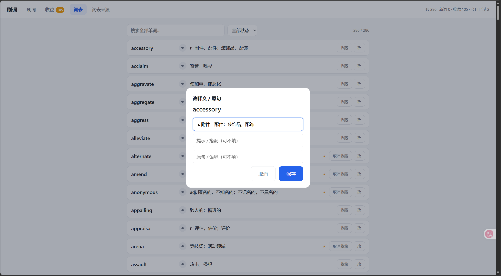

# 刷词

做阅读时遇到不会的词，粘进去，联网自动补上中文释义，然后按间隔反复刷到记住为止。

一个 Python 文件加一个网页，不装任何第三方依赖，数据全在你自己电脑上。

## 为什么做这个

复习六级的时候我每天做阅读，一篇下来能碰上十几个不认识的词。这些词有个特点：**它们是我自己遇到的**，跟任何一本词汇书的顺序都对不上。

想存下来反复刷，试过几类工具都不顺手：

- **背单词 App**：词书是别人编好的，顺序固定。有些支持收藏，但加词要一个一个搜，搜出来还得自己挑义项。
- **Anki**：能存自己的词，也确实强大，但录一条卡片要填正面、填反面，做十张卡的时间够我把这篇阅读再读一遍。
- **词典 App 自带的生词本**：能存，复习是顺带做的，优先级和间隔不太对路，导出也麻烦。

所以自己写了一个。核心就三件事：**词是我自己的**、**释义不用我查**、**释义不对能改**。

## 功能

**批量加词，自动补释义。** 一次粘一批词进去，联网调有道，中文意思和音标自动补上，不用一个个查。

**划词收录。** 装了浏览器扩展之后，网页上划中一个英文单词，右键就能收进词库，连读到它的那句话一起存。

**释义随时能改。** 有道给的是通用义项，经常不是文章里的那个意思。看到不对直接改，改完永久生效，重新导入词表也不会被冲掉。

**原句。** 收词时可以带上遇到它的那句话。翻面之后才显示——原句也算提示，先看到就没得猜了。

**发音。** 卡片上和列表每行都有喇叭，刷词时按 `P` 也能念。走有道的美音。

**词形还原。** 阅读里遇到的多半是变形，`staples`、`running`、`carried`。直接查有道经常拿到「n. 主要产物（staple 的复数）」这种带括号的释义，现在会先还原成原形再查，拿到的是干净的「主要产品，支柱产品」。

**派生词。** 名词的形容词形式这类同根词，加词时一并存下来，翻面后显示在释义下面——`mortal` 会带出 `mortality` 和 `mortally`。跟补释义是同一次请求，不多打接口。屈折变形（`descent` 的 `descending`）和语义跑偏的（`staple` 的 `stapler`）会尽量剔掉。

**间隔复习。** 不认识的和记错的自动进收藏，按 1/1/2/4/7/15 天回来，连对到底自动标「已掌握」移出收藏。

**进度不丢。** 重开页面、重启服务都还在，接着上次继续，不是从头开始。

## 怎么用

### 一、加新词


阅读时遇到的词攒一批，打开「词表来源」页，粘进**批量加词**框，一行一个，勾上「顺手联网补全释义」，点「加入词库」。几秒钟后释义和音标就补上了，写进你指定的词表文件。

上面的「词表来源」是你现在用的词表，一个 md 文件，三种写法都认：

```
每行一个单词
| word | 中文意思 | 提示 |
word - 中文意思
```

不想手动粘的话，装 `extension/` 里的浏览器扩展，阅读时划词右键收走。Chrome 打开 `chrome://extensions`，开右上角「开发者模式」，点「加载已解压的扩展程序」，选 `extension/` 目录就行（Edge 一样）。

### 二、刷词

打开「刷词」页，看到一个词先自己想，然后：

- `1` 认识　`2` 不认识
- `空格` 翻面看意思，再按一下下一个
- `P` 发音　`S` 收藏 / 取消
- `E` 改释义　`R` 重来本轮

答错的词自动进收藏，理解错了点「其实记错了 ★」。

卡片默认只显示单词本身，音标和搭配提示要勾上「显示音标和搭配提示」才出来——分组名和提示会提前泄题（「法律/司法」这种分组名一看就知道方向）。

### 三、改释义



「词表」页每行右边有个「改」，点开就能改。刷词的时候按 `E` 也能直接调出来。

弹窗里三个框：**释义**、**提示 / 搭配**（可不填）、**原句 / 语境**（可不填）。改完点保存，写回本地释义库。

### 四、收藏和复习

「收藏」页按收藏时间排，默认最新在上，也能切成只看今天收的。

每个收藏词带 box 0-5，连续答对往上走，间隔 1/1/2/4/7/15 天，答错回 box 0，连对到顶自动标「已掌握」移出收藏。

## 安装

需要 Python 3.8 以上，别的什么都不用装（只用标准库）。

**Windows**：双击 `启动.bat`，它自己找 Python、起服务、开浏览器。黑窗口别关，关了服务就停。

**其他系统**或者想手动跑：

```bash
python server.py
```

端口从 8756 开始自动找空位，启动后会在窗口里打印地址。第一次打开是空的，按上面「加新词」走一遍就看到了。

## 适配你自己的电脑

**Python 找不到。** `启动.bat` 会依次试 Windows 的 `py -3` 启动器、PATH 里的 `python.exe`、`%LOCALAPPDATA%\Programs\Python\Python3x`、`C:\Python3x`、Anaconda / Miniconda / Miniforge 的常用位置。都不匹配的话，在项目目录里建一个 `python_path.txt`，里面写 `python.exe` 的完整路径：

```
E:\ananconda\python.exe
```

**词表放哪都行。** 桌面上放一个 `生词.md`，或者项目目录里的 `生词*.md`，服务启动时都会自动认。也可以在「词表来源」页添加任意路径。文件被挪走或者改名了不用管，启动时会自动找回来。

**端口被占了。** 默认从 8756 往上找到 8775。想固定：`python server.py --port=8760`。

**想躺床上用手机刷。** 默认只绑 `127.0.0.1`，只有本机能访问。同一 WiFi 下让手机也能开：

```bash
python server.py --host=0.0.0.0
```

启动后会打印局域网地址。这个模式没有登录鉴权，只在自己家的网络里用。

**换电脑、迁移数据。** 复制 `data/dict.json`、`data/progress.json` 和你的词表 md 就行。

## 说明

释义、音标、派生词和发音走有道的 `jsonapi`、`suggest`、`dictvoice` 接口（`jsonapi` 当主路，`suggest` 兜底）。这几个不是公开 API，是逆向出来的网页接口，仅供个人学习使用，别拿去商用或者高频抓取。断网也能刷已经存过的词，只是新词补不了释义。

**老词补派生词。** 已经有几百个词的时候，去「词表来源」页点「补派生词」，一次 40 个，没补完再点一次。撞上限流就停一会儿，补过的不会重来。同理，「重刷释义」能把早期只存了一个词性的释义补齐。

所有数据都在项目目录的 `data/` 里，没有账号，没有云同步，服务默认只绑本机地址。

## 许可

MIT
